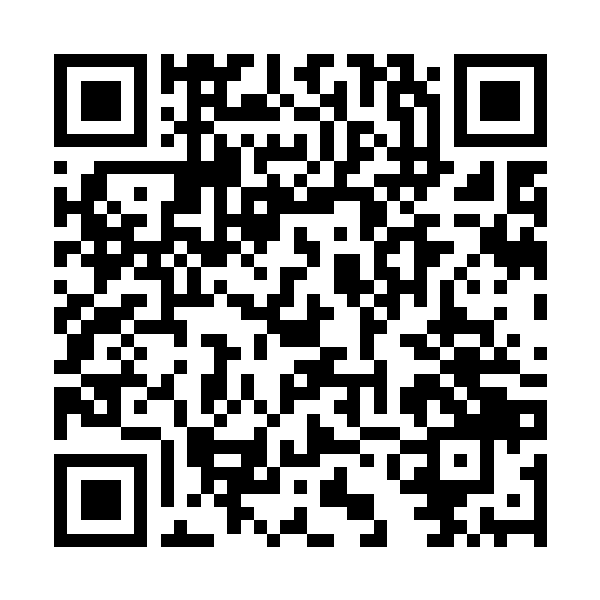

# オフサイドトラップ (Offside Trap)

サッカーの **オフサイド** をテーマにしたブラウザゲームです。
あなたは赤チームの守備ライン。ドリブルで攻めてくる相手がパスを出す瞬間に、ラインから遅れている DF をタップしてラインを上げ、
相手を **オフサイドトラップ** にかけます。遊びながら、オフサイドが成立する条件・成立しない条件を学べます。全 10 プレーで何回ピンチを止められるかを競います。
場面は 13 種類からランダムに選ばれ(同じ場面は 2 回まで・続けては出ない)、同じ場面でも選手の配置・ラインの高さ・遅れている DF・パスのタイミングは毎回変わります。

画面は **テレビ中継のようにメインスタンドの上から守備ラインを横から見る3D視点**(右が守るゴール)。ナイター照明のスタジアム・選手・ボタン・花火・歓声などの質感は
techgymjp/corner-kick(コーナーキック)と同じ作りです。

`index.html` をブラウザで開くだけで遊べます(ビルド不要)。3D描画に同梱の three.js(`vendor/three.min.js`, MIT License)を使っています。
GitHub Pages などの静的ホスティングにそのまま置けます。

## 1 プレーの流れ

1. **場面の紹介** — 「中央突破」「ロングボール」「スローイン」などを大きく表示
2. **ビルドアップ** — 相手(青)がドリブルやロングボール・スローイン・ゴールキック・フリーキックで攻めてくる。
   裏を狙う相手(9番)は、守備ラインの少し手前(オンサイド)に立って飛び出すタイミングを待つ
3. **パスの瞬間に DF を上げる** — 頭の上の番号のバッジをタップ(キーボードは 1〜4)すると、その DF が自動で前に出てラインを上げる
   - ラインを決めているのは「後ろから2人目の守備者」。遅れている DF を上げないとラインは上がらない
   - **早すぎる** と、9番はラインの動きを見て、オンサイドの位置まで戻ってしまう
   - **遅すぎる**(パスのあと)と意味がない。判定はボールを蹴った瞬間
4. **判定(VAR)** — パスの瞬間にスローモーションになり、カメラが副審の位置(ラインの真横)へ動いて、
   「後ろから2人目の守備者」の線(赤)と受け手の線(黄/青)、その差(cm / m)を表示
5. **結果** — オフサイドポジションの受け手がボールに関わったところで副審が旗を上げ(電子音)、主審が笛を吹いて間接フリーキックの合図。
   オンサイドなら走り合いになり、DF が先に触ればクリア、受け手が先なら失点。最後に **なぜそうなったか** の解説が出る

ナビ ON なら、今のオフサイドライン(後ろから2人目の守備者の位置を示す赤い線)と、パスが出る合図(パサーの足元のオレンジの輪と「パスが来る!」)、
判断のチェックリスト(「スローイン・ゴールキック・コーナーキックから?ボールより後ろ?自陣?ならオフサイドなし」)が出ます。
ナビは答えを教えません。どの DF を上げるか、上げずに「マーク」するかは、ルールを使って自分で判断します。

## 再現しているオフサイドの条件(サッカー競技規則 第11条)

| 条件 | ゲームでの再現 |
| --- | --- |
| 頭・胴体・足が相手陣内にあり、**ボール**と**後ろから2人目の相手**の両方よりゴールラインに近いとオフサイドポジション | パスの瞬間の位置で判定。差を cm / m で表示 |
| **同じ高さ**はオンサイド | 差が 10cm 未満は「同じ高さ → オンサイド」 |
| 判定は **味方がボールをプレーした瞬間** | 早すぎ(相手に戻られる)・遅すぎ・パスのあとのタップはすべて失敗 |
| **ロングパス** でも判定はキックの瞬間 | ロングボールの場面。蹴ったあとの飛び出しは関係ない |
| オフサイドポジションにいる **だけでは反則ではない**(プレーに関わると反則) | 旗は受け手がボールに関わったときに上がる。「2人が裏を狙う」では、おとりの11番がオフサイドポジションでも、パスを受けない限り反則にならない |
| **後ろから2人目** は GK も数える | 「キーパーが前に」: GK が前に出ていて、その後ろに DF が残っている。上げるべきは GK の後ろの DF |
| **自陣** にいる選手はオフサイドにならない | 「高いライン」: 9番は自陣から走り出す。上げずにカバーするのが正解 |
| **ボールより後ろ** の選手はオフサイドにならない | 「サイドをえぐられた」: ゴールライン近くからのマイナスのパス(カットバック) |
| **ゴールキック・スローイン・コーナーキック** からはオフサイドにならない | 「スローイン」「ゴールキック」「コーナーキック」: ラインを上げるとマークが外れて失点。上げずに競り合うのが正解 |
| ピッチの外に出た守備者は **ゴールライン上にいる** とみなす | 「DFがピッチの外に」: 倒れた DF がゴールラインの外にいるので、後ろから2人目は GK。上げてもオフサイドにならない |
| GK が **手で投げた** ボールはオフサイドがある(判定は手から離れた地点。2025/26 の改正) | 「キーパーのスロー」: スローインとちがって罠にかけられる |
| **フリーキック** からはオフサイドがある | 「フリーキック」: 遅れている DF が 2 人。2 人とも上げないとオフサイドにならない |

タイトル画面の「📘 オフサイドのルール」では、上の条件に加えて、相手が意図的にプレーしたボール・
GK が手で投げたボールの判定位置(2025/26 の改正)・罰則(間接フリーキック)もまとめています。
出典: IFAB Laws of the Game 2025/26 Law 11(日本語版: JFA サッカー競技規則)。

## 場面(13 種類からランダムに 10 プレー)

| 場面 | 正解 |
| --- | --- |
| 中央突破 | 遅れている DF 1 人をパスの瞬間に上げる |
| ラインがそろっていない | 遅れている DF 2 人を両方上げる |
| ロングボール | 相手陣内からのロングボール。遅れている DF を上げる |
| 2人が裏を狙う | ラインを決めている DF を上げる。おとりのオフサイドポジションは反則ではない |
| キーパーが前に | GK の後ろに残っている DF を、少し早めに上げる |
| フリーキック | 遅れている DF 2 人を両方上げる |
| キーパーのスロー | 遅れている DF を上げる(GK のスローはオフサイドがある) |
| スローイン | 上げない(スローインからはオフサイドなし)。マークの DF が競り勝つ |
| ゴールキック | 上げない(ゴールキックからはオフサイドなし) |
| コーナーキック | 上げない(コーナーキックからはオフサイドなし) |
| サイドをえぐられた | 上げない(ボールより後ろの選手はオフサイドなし) |
| 高いライン | 上げない(自陣から走る選手はオフサイドなし)。カバーの DF が先に追いつく |
| DFがピッチの外に | 上げない(外に出た DF はゴールライン上とみなすので、後ろから2人目は GK) |

後半になるほど、相手の反応が速くなり、パスの振りかぶりが短くなり、遅れている DF とラインの差が小さくなります。

## 操作

| 操作 | タッチ / マウス | キーボード |
| --- | --- | --- |
| DF を上げる | DF の頭の上の番号のバッジ(または選手)をタップ | 1〜4(画面の奥の DF から順に) |
| マーク(体を寄せる) | 右の「マーク」ボタン | Space(または K) |
| 次のプレーへ(結果画面) | タップ | Space |
| 一時停止 | — | P / Esc |
| 音のオン/オフ | 画面上部のスピーカーボタン | M |
| ナビのオン/オフ | 画面上部の「ナビ」ボタン | N |

## スコア

- オフサイド成功: 1000 + タイミング(パスの直前ほど高く、最大 300)。パスの 0.7 秒前以内なら「ジャストタイミング!」
- オフサイドにならない場面で上げずに「マーク」で守った: 1000(「ナイス判断!」)。そのほかのクリア・キャッチ: 600
- オフサイドを取る場面で、上げる必要のない DF(遅れていない DF)を上げると、1 人につき −300。さらに、そのDFが空けたスペースへ 7 番が走り込み、パスが出ると失点する(余計な DF が 1 人なら半分の確率、2 人以上なら必ず)
- ナビを使わずに守ると、そのプレーの得点が 1.5 倍(そのプレーの途中で一度でもナビを ON にすると付かない)
- 連続成功でボーナス、3 連続ごとに花火を追加
- ベスト記録はブラウザに保存されます。結果画面から X・LINE・コピー・成績画像つきでシェアできます。
  シェア文には紹介記事 https://techgym.jp/column/claude-code-game-offside/ が入ります

## 音と演出

音はすべて Web Audio API で合成しています(音声ファイルなし)。

- スタジアムのざわめきと応援(太鼓と手拍子のリズム)。パスが出てゴール前に近づくほどどよめきが大きくなる
- DF が前に出る「ザッ」、キック、ヘディング、ネットを揺らす音、キーパーのキャッチ
- パスの瞬間はスローモーション(VAR の判定)
- **副審の旗の電子音「ピピッ」**、主審の笛、オフサイド成功で大歓声・拍手・指笛・花火
- 失点すると観客のため息「あー…」

## 言語

日本語と英語に対応しています。端末の言語が日本語なら日本語、それ以外は英語で表示し、タイトル画面左下のボタンで切り替えられます。
文言は `i18n.js` にまとめています。

## Android アプリ

[Capacitor](https://capacitorjs.com/) でゲームのファイルをアプリに同梱し、Android アプリにしています(オフラインで遊べます)。
構成は techgymjp/jet-fighter の `docs/ANDROID_PORTING.md`、techgymjp/corner-kick と同じです。

- パッケージ名: `jp.techgym.offside`
- 横画面固定・全画面・プレイ中は画面を消さない
- 戻るボタン: プレイ中は一時停止(ポーズ中なら再開)、タイトル・結果画面ではアプリを終了(ルールの説明を開いているときは閉じる)
- 別アプリに切り替えると自動で一時停止して音を止める
- シェアは Android の共有メニュー(紹介記事の URL つき)
- 広告(AdMob)
  - バナー: タイトル画面(操作説明・ルールのページを含む)・ポーズ画面・結果画面の下中央(プレイ中は操作ボタンと重なるので出さない)
  - 全画面広告(インタースティシャル): プレイを始めるとき(トップ・操作説明・ルールのページから)、結果画面の「もう一度」、「タイトルへ」、操作説明・ルールのページから「タイトルに戻る」、ポーズ画面からの「再開」のたびに毎回
  - リワード広告(チート): 失点したら「広告を見てこのプレーをやり直す」(1 ゲーム 5 回まで。失点の様子と解説を見届けられるよう 2.6 秒後に出し、6 秒で自動的に次のプレーへ)。
    見終わるとそのプレーの成績を取り消して、同じプレー(同じ配置)をもう一度。使ったことは結果画面とシェア文に「やり直しN回」と出る
  - EU など同意が必要な地域ではタイトル画面に「広告の設定」
- タイトル画面にバージョン(ビルド番号)とプライバシーポリシーへのリンク

ビルドは GitHub Actions(`.github/workflows/android.yml`)で行います。

1. `npm ci` → `npm run build`(`www/` に Web ファイルをコピーし、`ads-config.js` と `build-info.js` を生成)→ `npx cap sync android` → `./gradlew assembleDebug`
2. 既定ブランチなら、Release `android-latest` の `offside.apk` を差し替え(動作確認用・テスト広告)
   - リリース画面: `https://github.com/techgymjp/offside/releases/tag/android-latest`(QR コード: `docs/apk-qr.png`)
   - APK 直接: `https://github.com/techgymjp/offside/releases/latest/download/offside.apk`
3. GitHub Secrets に署名鍵(`ANDROID_KEYSTORE_BASE64` / `ANDROID_KEYSTORE_PASSWORD` / `ANDROID_KEY_ALIAS` / `ANDROID_KEY_PASSWORD`)があれば、本番広告で署名付き AAB を作り Artifact に上げる

AdMob のアプリ ID は `android/app/src/main/res/values/strings.xml` の `admob_app_id`、本番の広告ユニット ID は `ads.js` の `UNITS.production` にあります。
本番の広告ユニット ID はバナー・インタースティシャル・リワードの 3 つとも入っています(空にした種類は Google Play 用の AAB では出さない)。
動作確認用 APK はどれもテスト広告、Google Play 用の AAB は本番の広告です。

Google Play のストア掲載情報(日英の紹介文・リリースノート)とスクリーンショット・フィーチャーグラフィックは `docs/store/` にあります(`docs/store/listing.md`)。

手元で試すとき: `npm install` → `npm run android:sync` → `npm run android:open`(Android Studio が必要)。
アイコンと起動画面は `assets/` の元画像(夜のスタジアムで副審の旗とオフサイドライン)から作っています。

## ファイル

| ファイル | 内容 |
| --- | --- |
| `game.js` | ゲームの進行・場面づくり・オフサイドの判定・選手とボールの動き・入力・2D の表示(HUD・バッジ・VAR・解説・ミニマップ) |
| `scene3d.js` | 3D 描画(スタジアム・ゴールとネット・選手・副審の旗・ボール・オフサイドライン・花火・カメラ) |
| `sound.js` | 音(Web Audio API で合成) |
| `i18n.js` | 日本語 / 英語の文言(ルールの説明を含む) |
| `ads.js` | 広告(AdMob。Android アプリのときだけ動く) |
| `android/` `capacitor.config.json` `scripts/build-web.js` | Android アプリ(Capacitor) |

テスト用に `window.Offside`(`newGame(seed)`、`startAt(index, seed)`、`update(dt)`、`setBot(fn)`、`tap(key)`、`forceKind` など)を公開しています。

## ライセンス

著作権はテックジム株式会社に帰属します(All rights reserved)。許可なく複製・改変・再配布すること、Web サイトやアプリとして公開・販売すること、名前・ロゴ・アイコン・画像を使うことを禁止します。
テックジムの受講生が学習目的で複製・改変することは許可しますが、アプリストアでの公開・広告の掲載・販売などの商用利用は禁止し、著作権表示を残してください。
同梱の three.js は MIT License です。詳しくは [LICENSE](LICENSE) を見てください。

## English

**Offside Trap** — a 3D football browser game about the offside trap and the offside law.

- You control the red back line, seen from a TV-style camera high in the main stand. Tap the defender who is lagging behind (or press 1–4) right as the pass is played — he steps up and springs the trap.
- Too early and the striker drops back onside; after the pass is too late. A VAR slow-motion shows the second-last defender's line, the receiver's line and the gap, and the assistant referee flags once the offside player gets involved.
- Each game picks 10 plays at random from 13 situations, with new player positions every time. They cover the key conditions of Law 11: the moment of the pass, long balls, level = onside, the keeper counting as an opponent, passive offside, own half, behind the ball, no offside from throw-ins, goal kicks and corners (free kicks and keeper's throws do count), and a defender off the pitch counting as on the goal line. Each result comes with a short explanation.
- Open `index.html` in a browser to play.
